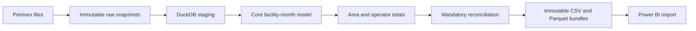

# Alberta Gas Production Intelligence Platform

A Python, SQL and DuckDB pipeline for tracing reported natural-gas production to
public Petrinex source files, with validated exports for Power BI.

**Status: the full-window warehouse works with a provisional study scope.**
The January 2024–December 2025 run, plus December 2023 context, loaded 13,783,410
source rows into a fixed 551-facility model. Validated CSV/Parquet reporting exports
contain exactly 24 analysis months. Area/operator changes, concentration and ranked
facility drivers are implemented. Power BI and the signed production-change bridge
remain pending.

The working study definition is facilities in the Kakwa area of Alberta
(Twp 60–65, Rge 3–7 W6M), with a fixed January 2024–December 2025 analysis window.
Pilot runs use an explicit subset of months. Full-window runs consume a pinned
candidate cohort artifact. Exports label this working scope and preserve the
actual approval status. Final scope confirmation and source-contract exit review
remain pending; a working warehouse does not certify final portfolio findings.



## Run

Use Python 3.11 or newer from the repository root:

```bash
python3.11 -m venv .venv
source .venv/bin/activate
python -m pip install -e ".[dev]"
gas-intel run-all --month 2025-01 --month 2025-02
```

The first run acquires missing explicitly requested months. Subsequent runs reuse
pinned local inventories. To prohibit all network access:

```bash
gas-intel run-all --month 2025-01 --month 2025-02 --offline
```

For a full-window run, first restore the reviewed source inventory and prepare
its cohort with `python -m gas_intel.cohort`. Use the returned artifact path:

```bash
gas-intel run-all --cohort-artifact data/processed/cohorts/<sha256>.json --offline
```

This selects all 24 configured analysis months plus the fixed preceding context
month. Do not combine `--cohort-artifact` and `--month`. The artifact pins one exact
source revision per month and independently calculated cohort baselines.

The same operations can be inspected separately:

```bash
gas-intel load --month 2025-01 --month 2025-02 --offline
gas-intel build
gas-intel validate
gas-intel export
```

Use `--project-root /path/to/repository` when running elsewhere. CLI failures exit
nonzero. Months must be unique, explicit and inside the configured analysis/context
window. An unavailable month fails rather than becoming zero production.

## What the pipeline guarantees

- Source bytes are immutable and identified by hash; revisions are retained.
- Staging preserves source strings, leading-zero IDs and row/file/run provenance.
- Reloading replaces the selected snapshot transactionally without duplicating it.
- The full-window cohort is pinned to the 24 analysis months; context cannot add members.
- Context is retained for comparison in the database and excluded from reporting exports.
- Operators are assigned by reporting month; UNKNOWN remains in totals.
- Positive, explicit-zero and absent qualifying rows remain distinct.
- Selected invalid volumes, duplicate detail, operator conflicts and location
  conflicts stop the model build; a failed transaction does not publish a partial model.
- Source, staging, core, area and operator totals must reconcile exactly by month.
- Export always validates the current raw hashes, configuration, model and tables.
  It reads a consistent database transaction and cannot reuse a stale validation pass.
- Full staging and built-table fingerprints detect detail, lineage, share or
  reporting-count changes even when monthly volume totals remain unchanged.
  Modified staging requires reloading; modified derived tables require rebuilding.
- Export writes a new bundle, then atomically updates latest.json. Failure leaves
  the previous accepted bundle available.

The pipeline does not explain operational causes, identify formations, infer
ownership transfers, or treat absent reports as proven shut-ins.

## Outputs

The local database is `data/warehouse.duckdb`. `data/exports/latest.json` identifies
the accepted bundle containing ten tables in CSV and Parquet, a manifest with
file hashes, source/configuration/model metadata and a validation report.

[Power BI model and first visual](dashboard/model.md) documents actual export grains
and import relationships. A dashboard has not been created yet.

## Analytical outputs

- Area month-over-month and year-over-year changes using exact calendar baselines.
- Operator monthly changes that retain entries, exits and UNKNOWN attribution.
- Top-1/3/5 operator shares and HHI, with UNKNOWN share alongside concentration.
- Ranked facility increases/decreases with both operators, reporting states and
  nullable observed volumes preserved.

[Analytics definitions](docs/analytics.md) explain units, zero/missing baselines,
rank ties and interpretation limits. Independent Python/Decimal checks recompute
these SQL results before publication. These are reported-contribution comparisons;
the signed operator reallocation bridge is still pending.

## Verified full-window result

- Analysis window: January 2024–December 2025; context: December 2023.
- Fixed cohort: 551 facilities; warehouse spine: 13,775 facility-month rows.
- Reporting exports: 24 months, 13,224 facility-month rows and 8,120 production facts.
- All 25 monthly source/core/operator/area checks passed; all 20 export file hashes checked.
- No UNKNOWN production fact operators were observed. Absent qualifying rows remain warnings.

See [full-window validation evidence](docs/evidence/full_window_warehouse_validation.json)
and [current analytics validation](docs/evidence/analytics_validation.json).
This is a working candidate study, not approved final findings or a completed dashboard.

## Verified pilot result

| Month | Reported volume (e3m3) | Qualifying facilities | Operators |
|---|---:|---:|---:|
| 2025-01 | 1,366,116.000 | 337 | 20 |
| 2025-02 | 1,202,281.300 | 342 | 20 |

The two-month cohort has 477 facilities with any source rows inside the box. It is
not the 551-facility union previously researched across the entire 24-month window.
See [pilot validation evidence](docs/evidence/pilot_warehouse_validation.json).
These numbers describe reported extract contributions, not all physical gas output.

## Tests and source verification

```bash
pytest
ruff check .
ruff format --check .
```

Offline fixture tests exercise the full CLI/pipeline, exact totals, historical
operators, missing-versus-zero states, rollback, reruns, corrupt sources, configuration
changes, total-preserving detail corruption and export blocking. They do not require
public source files in CI.

The earlier [source audit](docs/source_verification.md) and
[full-window research](docs/window_verification.md) remain provenance evidence.
All 24 analysis-month raw snapshots and December 2023 context have now been
restored with hashes matching the earlier evidence. The warehouse now consumes
the full-window cohort. `python -m gas_intel.cohort` prepares a pinned candidate cohort
and independently reconciled monthly baselines; see
[cohort preparation](docs/window_verification.md). Historical reference snapshots
remain unavailable locally. Provider revisions may prevent recreation of earlier
exact hashes in future; never silently update reviewed expectations.

## Next

Complete the final scope/source review, implement the reconciled production-change
bridge, then build Power BI with evidence-backed findings. See [PLAN.md](PLAN.md).

Raw files, warehouses, generated bulk exports, environments and secrets stay out
of Git. Source copyright acknowledged: Government of Alberta, Petrinex public data.
Use remains subject to [Petrinex terms](https://www.petrinex.ca/terms).
