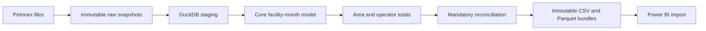

# Alberta Gas Production Intelligence Platform

A Python, SQL and DuckDB pipeline for tracing reported natural-gas production to
public Petrinex source files, with validated exports for Power BI.

**Status: the first real-data warehouse pipeline works.** A two-month run for
January–February 2025 loaded 1,121,054 source rows and produced validated CSV and
Parquet exports. The Power BI dashboard and production-change bridge are pending.

The working study definition is facilities in the Kakwa area of Alberta
(Twp 60–65, Rge 3–7 W6M), with a fixed January 2024–December 2025 analysis window.
Pilot runs use an explicit subset of months. The exports label this working scope
and preserve the actual approval status; development no longer waits on the old
AGENTS.md confirmation gates, which the user retired on October 19, 2026.



## Run

Use Python 3.11 or newer from the repository root:

```bash
python3.11 -m venv .venv
source .venv/bin/activate
python -m pip install -e ".[dev]"
gas-intel run-all --month 2025-01 --month 2025-02
```

The first run acquires missing explicitly requested months. Subsequent runs reuse
pinned local inventories. To prohibit all network access:

```bash
gas-intel run-all --month 2025-01 --month 2025-02 --offline
```

The same operations can be inspected separately:

```bash
gas-intel load --month 2025-01 --month 2025-02 --offline
gas-intel build
gas-intel validate
gas-intel export
```

Use `--project-root /path/to/repository` when running elsewhere. CLI failures exit
nonzero. Months must be unique, explicit and inside the configured analysis/context
window. An unavailable month fails rather than becoming zero production.

## What the pipeline guarantees

- Source bytes are immutable and identified by hash; revisions are retained.
- Staging preserves source strings, leading-zero IDs and row/file/run provenance.
- Reloading replaces the selected snapshot transactionally without duplicating it.
- The cohort is a fixed union of in-box facilities across the loaded months.
- Operators are assigned by reporting month; UNKNOWN remains in totals.
- Positive, explicit-zero and absent qualifying rows remain distinct.
- Selected invalid volumes, duplicate detail, operator conflicts and location
  conflicts stop the model build; a failed transaction does not publish a partial model.
- Source, staging, core, area and operator totals must reconcile exactly by month.
- Export always validates the current raw hashes, configuration, model and tables.
  It reads a consistent database transaction and cannot reuse a stale validation pass.
- Export writes a new bundle, then atomically updates latest.json. Failure leaves
  the previous accepted bundle available.

The pipeline does not explain operational causes, identify formations, infer
ownership transfers, or treat absent reports as proven shut-ins.

## Outputs

The local database is `data/warehouse.duckdb`. `data/exports/latest.json` identifies
the accepted bundle containing eight tables in CSV and Parquet, a manifest with
file hashes, source/configuration/model metadata and a validation report.

[Power BI model and first visual](dashboard/model.md) documents actual export grains
and import relationships. A dashboard has not been created yet.

## Verified pilot result

| Month | Reported volume (e3m3) | Qualifying facilities | Operators |
|---|---:|---:|---:|
| 2025-01 | 1,366,116.000 | 337 | 20 |
| 2025-02 | 1,202,281.300 | 342 | 20 |

The two-month cohort has 477 facilities with any source rows inside the box. It is
not the 551-facility union previously researched across the entire 24-month window.
See [pilot validation evidence](docs/evidence/pilot_warehouse_validation.json).
These numbers describe reported extract contributions, not all physical gas output.

## Tests and source verification

```bash
pytest
ruff check .
ruff format --check .
```

Offline fixture tests exercise the full CLI/pipeline, exact totals, historical
operators, missing-versus-zero states, rollback, reruns, corrupt sources, configuration
changes and export blocking. They do not require public source files in CI.

The earlier [source audit](docs/source_verification.md) and
[full-window research](docs/window_verification.md) remain provenance evidence.
Following recovery of the deleted local checkout, only the two pilot raw months
have been reacquired; the other source files must be reacquired before extending
the actual warehouse to the full window. Provider revisions may prevent recreation
of earlier exact hashes; never silently update reviewed expectations.

## Next

Extend the tested model to the complete window and comparison context, formalize
the full-period cohort, add the reconciled production-change bridge, then build
Power BI and write evidence-backed findings. See [PLAN.md](PLAN.md).

Raw files, warehouses, generated bulk exports, environments and secrets stay out
of Git. Source copyright acknowledged: Government of Alberta, Petrinex public data.
Use remains subject to [Petrinex terms](https://www.petrinex.ca/terms).
