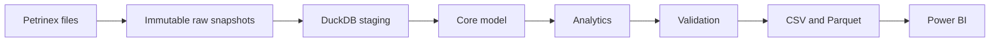

# Alberta Gas Production Intelligence Platform

A planned Python, SQL, DuckDB and Power BI pipeline to examine changes in publicly
reported natural gas production for facilities in Alberta's Kakwa area.

**Status: Stage 1 foundation implemented (legacy name M0).** No production data has been loaded and no
dashboard or analytical findings exist yet. Source interpretation, the exact DLS
study boundary and fixed 24-month window remain subject to M1 verification.



## Setup

Use Python 3.11 or newer. From the repository root:

```bash
python3.11 -m venv .venv
source .venv/bin/activate
python -m pip install -e ".[dev]"
gas-intel --help
gas-intel doctor
pytest
ruff check .
ruff format --check .
```

`doctor` checks runtime and YAML template readability only. It explicitly reports
that source contracts remain unverified. `doctor --require-sources` fails until
a later milestone implements real contract verification. Use `--config-dir` to
check a different configuration directory.

`download`, `load`, `build`, `validate`, `export` and `run-all` are honest stubs:
they exit with code 2 and perform no pipeline work. No networking, database
creation or export takes place in M0.

## Next stage

Complete Stage 2 using the [source checklist](docs/m1_checklist.md), then deliver
the first working month in Stage 3 before expanding to 24 months. See [PLAN.md](PLAN.md) and
[AGENTS.md](AGENTS.md) for the bridge definitions and acceptance requirements.

Missing rows do not establish zero output or physical shut-in. Reporting-month
operators do not establish asset ownership. Source revisions must be retained;
raw data, local warehouses and generated bulk exports are excluded from Git.
Power BI is built manually from validated exports in a later milestone.
